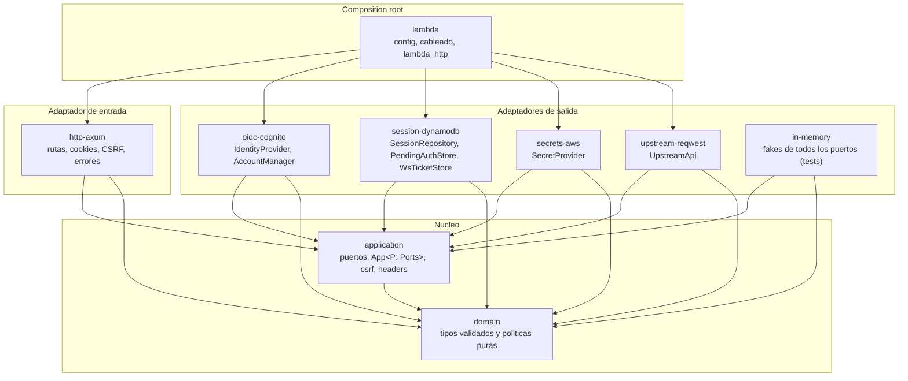

# Arquitectura

El BFF es un servicio hexagonal: el nucleo (`domain`, `application`) no sabe nada de AWS, HTTP
ni OIDC, y todo lo que toca el mundo exterior es un adaptador que implementa un puerto. El
unico crate que conoce a todos es `lambda`, el *composition root*.

## Capas

Las flechas son dependencias de compilacion: apuntan hacia el nucleo y nunca al reves.
`workspace-tests` depende de todo (solo como `dev-dependencies`) y aloja la suite de
seguridad, los tests HTTP, los de contrato y el de arquitectura. `fuzz/` queda fuera del
workspace.

## Reglas de dependencias (las hace cumplir el test de arquitectura)

`crates/workspace-tests/tests/architecture.rs` lee `cargo metadata` y falla si:

| Crate | Regla |
|---|---|
| `domain` | Solo puede depender (directo) de `base64`, `secrecy`, `sha2`, `subtle`, `thiserror` y `zeroize`. |
| `application` | Solo de `domain`, `thiserror` y `tracing`. |
| `domain` y `application` | Ninguna dependencia **transitiva** a `tokio`, `reqwest`, `hyper`, `axum`, `openidconnect`, `serde`, `lambda_http`, `lambda_runtime` ni a ningun crate `aws_*`. |
| adaptadores (`crates/adapters/*`) | No pueden depender de otro adaptador ni de `lambda`: se hablan solo a traves de `application`. |
| `lambda`, `workspace-tests` | Sin restriccion. |
| cualquier otro crate | Falla: hay que clasificarlo en `clasificar` del test y definir sus reglas. |

Solo cuentan las dependencias normales. `cargo deny` cubre advisories, licencias, fuentes y
duplicados; no restringe dependencias por crate (por eso existe el test).

La feature `fuzzing` de `http-axum` solo expone, bajo `#[doc(hidden)] pub mod fuzzing`, dos
funciones finas sobre parsers privados. No esta activa en ningun build normal; solo `fuzz/`
la enciende.

## Puertos y adaptadores

`application::ports::Ports` agrupa los puertos con tipos asociados, y `App<P: Ports>` es
generico sobre el. No hay `dyn`: todo se monomorfiza. Los metodos asincronos devuelven
`impl Future + Send` (RPITIT), sin `async-trait`.

| Puerto | Responsabilidad | Adaptador real | Fake |
|---|---|---|---|
| `IdentityProvider` | URL de autorizacion, canje de `code`, refresh, revocacion, URL de logout; valida el ID token. | `oidc-cognito::CognitoIdp` | `in-memory::FakeIdp` |
| `AccountManager` | Estado y alta de TOTP, preferencia de MFA, cambio de contrasena. | `oidc-cognito::CognitoAccount` | `in-memory::FakeAccount` |
| `SessionRepository` | CRUD con `version` y lease de refresh. | `session-dynamodb::DynamoSessions` | `in-memory::MemSessions` |
| `PendingAuthStore` | `put` y `consume` atomico del login en curso. | `session-dynamodb::DynamoPending` | `in-memory::MemPending` |
| `WsTicketStore` | `put` y `consume` atomico del boleto de WebSocket. | `session-dynamodb::DynamoTickets` | `in-memory::MemTickets` |
| `UpstreamApi` | `forward` de la peticion ya validada y filtrada. | `upstream-reqwest::ReqwestUpstream` | `in-memory::FakeUpstream` |
| `Clock`, `RandomGenerator` | Hora y aleatoriedad, controlables en tests. | `lambda::system` (`SystemClock`, `OsRng`) | `in-memory::TestClock`, `TestRng` |
| `SecretProvider` | Secretos con cache TTL e `invalidate`. No esta en `Ports`: lo usan los adaptadores. | `secrets-aws::CachedSecrets` (y `EnvSecretProvider` con `--features local`) | `FakeSecrets` dentro de los tests |

Ningun tipo de una libreria externa aparece en las firmas de los puertos. Los errores de los
adaptadores son `AdapterError` (transitorio o permanente, sin detalles internos) y
`application` los convierte en `AppError`, que `http-axum` traduce a `{"error","requestId"}`.

Los tests de contrato (`crates/workspace-tests/tests/contrato`) corren la misma bateria contra
`in-memory` y contra `session-dynamodb` en DynamoDB Local: el fake no puede desviarse de la
semantica real sin que falle un test.

## Flujos en forma corta

Todas las rutas pasan por tres middlewares, de afuera hacia adentro: contexto (`X-Request-ID`,
span), `X-Origin-Verify` (si esta configurado) y CSRF (metodos que cambian estado).

**Login** (`GET /auth/login?returnTo=`): con sesion valida redirige a `returnTo`. Si no, genera
`pending_id`, `state`, `nonce` y `code_verifier` (PKCE S256), guarda `PENDING#` (10 min), pone la
cookie `__Host-bff_pending` y redirige `303` a Cognito.

**Callback** (`GET /auth/callback`): consume el pending (una sola vez, atomico); valida
`error`, `state` (tiempo constante); canjea el `code` (PKCE, `nonce`, ID token); crea una sesion
con ID nuevo (borra la anterior si venia una), pone `__Host-bff_session`, borra el pending y
redirige `303` a `return_to`. Cualquier fallo despues de consumir el pending termina en
`AUTH_ERROR_REDIRECT_PATH?code=<codigo de lista blanca>` sin cookie de sesion.

**Sesion vigente** (`EnsureFreshSession`, usada por `/auth/me`, `/api/*`, `/auth/ws-ticket` y
`/auth/account/*`): lee la sesion por `sha256(id)`; rechaza si vencio por TTL, vida absoluta o
inactividad; si el access token esta por vencer, un solo invocante toma el lease en DynamoDB,
llama a Cognito y guarda los tokens nuevos; el resto espera con backoff y relee.

**Logout** (`POST /auth/logout`): revoca el refresh token (si falla, sigue), borra la sesion,
borra la cookie y responde `200 {"logoutUrl"}`.

**Proxy** (`ANY /api/*`): CSRF, `ProxyPath`, cuerpo acotado, `EnsureFreshSession`; reenvia al
`UPSTREAM_BASE_URL` con la lista blanca de cabeceras y `Authorization: Bearer <access>`; filtra
`Set-Cookie` y hop-by-hop de la respuesta.

**Boleto WS** (`POST /auth/ws-ticket`): sesion valida; genera 256 bits aleatorios, guarda
`WSTICKET#<hash>` con `session_hash` y `UserInfo` (30 s) y devuelve `{"ticket","expiresIn"}`.

El detalle de cada flujo esta en el plan de diseno (secciones 6, 18 y 19).

## Como reemplazar un adaptador

Ejemplo: guardar sesiones, pending y boletos en **Redis** en lugar de DynamoDB. El nucleo y
`http-axum` no se tocan.

1. **Crea el crate** `crates/adapters/session-redis` (`Cargo.toml` con las claves del
   workspace). `members` ya incluye `crates/adapters/*` y el test de arquitectura lo clasifica
   como adaptador por su ruta. Dependencias: `application`, `domain`, `thiserror` y el cliente
   (`redis` con `tokio-comp`). Revisa que la version tenga mas de 2 semanas y que pase
   `cargo deny check` (licencias y fuentes).

2. **Implementa los tres puertos de almacenamiento** con los mismos nombres de tipo que el
   adaptador actual (`RedisSessions`, `RedisPending`, `RedisTickets`):
   - `SessionRepository`: `create` con `SET clave valor NX` (si ya existe, error permanente);
     `update_if_version` y `acquire_refresh_lease` como **scripts Lua** (comparan `version` y
     `refresh_lock_until` y escriben en un solo paso, para conservar la atomicidad que exige el
     contrato); `delete` con `DEL` (idempotente).
   - `PendingAuthStore` y `WsTicketStore`: `put` con `SET NX`; `consume` con `GETDEL`, que lee
     y borra de forma atomica.
   - Claves: `SESSION#<sha256(id)>`, `PENDING#...`, `WSTICKET#...` (el mismo prefijo por tipo
     que usa el adaptador de DynamoDB, para que los namespaces no se pisen).
   - El `ttl` del puerto es un `Timestamp` absoluto: usa `PEXPIREAT`. Redis expira por TTL de
     forma aproximada, igual que DynamoDB, asi que `application` ya verifica la vigencia en
     codigo y no hace falta cambiar nada.
   - Convierte todo error del cliente en `AdapterError::Transient` o `Permanent`, sin
     incluir el mensaje del servidor.

3. **Pasa el contrato.** Agrega `crates/workspace-tests/tests/contrato/redis.rs` con un
   `Harness` que implemente `suite::Harness` (como `dynamo.rs`: un prefijo o base de datos por
   test y las sondas `session_ttl`, `session_has_lock_attr`, `pending_ttl` y `ticket_ttl`).
   En `contrato/main.rs` declara `mod redis;` y agrega un modulo `en_redis` en la macro
   `contrato!`, igual que `en_dynamodb`. La bateria completa (50 leases concurrentes, `consume`
   concurrente, limites exactos de TTL) debe pasar contra un Redis real; en CI, un service
   container `redis` y una variable `REDIS_URL`.

4. **Cambia el cableado** en `crates/lambda/src/wiring.rs`: en `BffPorts`, sustituye los tipos
   `DynamoSessions`, `DynamoPending` y `DynamoTickets` (campos y `type Sessions = ...`) por los
   de Redis, y en `build` crea el cliente en lugar de `aws_sdk_dynamodb::Client`. Agrega
   `REDIS_URL` a `config.rs` (con su prueba de configuracion invalida) y quita
   `SESSIONS_TABLE` y `DYNAMODB_ENDPOINT_URL` si ya no se usan. Para soportar ambos, hazlo
   con una feature de cargo en `lambda` en vez de borrar el codigo de DynamoDB.

5. **Ajusta la infraestructura**: el modulo `bff` crea la tabla y los permisos de DynamoDB; con
   Redis (p. ej. ElastiCache) la Lambda necesita VPC, un security group y la variable
   `REDIS_URL`, y el techo de permisos del bootstrap deja de necesitar `dynamodb:*`.

6. **Verifica**: `cargo test --workspace` (incluye contrato y arquitectura), `cargo deny check`,
   y la suite de seguridad completa: no cambia, porque corre contra `in-memory` y las reglas
   del nucleo.

El mismo procedimiento sirve para cualquier otro puerto: un proveedor de identidad distinto
de Cognito implementa `IdentityProvider` (y `AccountManager`, o un fake que responda que la
cuenta no se gestiona aqui), y se prueba con las mismas pruebas de seguridad de `oidc`.
